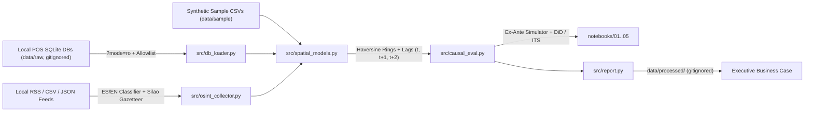

# business-geo-analytics

**Spatio-Temporal Retail Analytics: Separate External Street Shocks from Storefront Performance & Prove Operational ROI**

*Open-source toolkit to isolate local OSINT foot-traffic shocks, diagnose storefront proximity sensitivity, and build ex-ante and post-launch causal ROI business cases for retail queue interventions.*

---

## Architecture



---

## Quickstart (Sample Mode — Out of the Box)

All 5 notebooks, tests, and the report simulator run out of the box on synthetic sample data in [`data/sample/`](data/sample/) without access to private databases.

```bash
uv venv --python 3.12 .venv
uv pip install --python .venv/bin/python -r requirements.txt

# Regenerate deterministic synthetic sample CSVs
.venv/bin/python -m src.generate_sample

# Run full test suite (including headless notebook execution)
.venv/bin/python -m pytest -q

# Verify repository security, schemas, and smoke pipeline
.venv/bin/python scripts/verify_repo.py
```

Run notebooks in sample mode (default `BGA_DATA_MODE=sample`):

```bash
.venv/bin/jupyter lab notebooks/
```

---

## Docker Quickstart

`.dockerignore` blocks `data/raw/`, `data/processed/`, `*.db`, `*.sqlite*`, `.env`, and `.git/` so private databases and credentials never enter an image layer. The container runs as non-root `appuser` and defaults to `BGA_DATA_MODE=sample`.

**Open-source sample mode (out of the box):**

```bash
docker compose up
```

**Local private-data mode (mounts `./data/raw` strictly read-only as `:ro`):**

```bash
BGA_DATA_MODE=raw docker compose up
```

**Run tests or generate the executive report via container tools:**

```bash
docker compose --profile tools run --rm test
docker compose --profile tools run --rm report
BGA_DATA_MODE=raw docker compose --profile tools run --rm report
```

---

## Private Local Mode & Configuration Overrides

To analyze a private local store (benchmark: **The Coffee – Paseo MS**, `TC-001`, Silao, Guanajuato):

1. Place `master_sales.db` and `kiosk.db` inside `data/raw/` (strictly gitignored).
2. Copy [`local_assumptions.example.json`](local_assumptions.example.json) to `data/raw/local_assumptions.json` (gitignored) and/or [`.env.example`](.env.example) to `.env` (gitignored) to override approximate coordinates (`20.95, -101.42`, `coords_verified=False`) and ROI placeholders via `BGA_*` environment variables.
   - Override precedence: `defaults < data/raw/local_assumptions.json < env BGA_*`
3. Set `BGA_DATA_MODE=raw` when running notebooks or generating a local executive report into `data/processed/` (gitignored):

```bash
BGA_DATA_MODE=raw .venv/bin/python -c "from src.report import generate_franchise_report; generate_franchise_report(mode='raw')"
```

---

## Adapting `src/db_loader.py` to Any POS Database

1. Update `MASTER_ALLOWLIST` in [`src/db_loader.py`](src/db_loader.py) with your POS table names and add any PII/credential tables to `TABLE_DENYLIST`.
2. Adjust column mappings inside `load_daily_sales()`, `load_hourly_sales()`, and `load_product_mix()` (preserving operating-hour clamping and multi-period coalescing).
3. Update `categorize_sku()` rules to map your menu items into `Beverages`, `Food_Pastries`, `Combos`, and `Retail`.

---

## Privacy & Security Design

- **Git Isolation:** [`.gitignore`](.gitignore) excludes `data/raw/*`, `data/processed/*`, `*.db`, `*.sqlite*`, `.env`, and `data/raw/local_assumptions.json`.
- **Read-Only + Allowlist Enforcement:** [`src/db_loader.py`](src/db_loader.py) opens SQLite via `?mode=ro` URI connections, exposes only explicit allowlisted tables and safe columns, and raises `RestrictedTableError` on `client_vault` or any PII/financial denylist table.
- **Zero Raw Leakage in Samples & Templates:** [`src/generate_sample.py`](src/generate_sample.py) builds `data/sample/*.csv` purely from hard-coded generic priors (never reads `data/raw/`). [`docs/master_franchise_report.md`](docs/master_franchise_report.md) stores only `{{placeholder}}` tokens, and `src/report.py` blocks writing `"raw"` reports outside `data/processed/`.

---

## Repository Layout

- [`src/config.py`](src/config.py): Store coordinates, geofence radii (`500m`, `1500m`, `5000m`), operating hours (`6..21`), peak windows, and ROI assumptions
- [`src/db_loader.py`](src/db_loader.py): Read-only SQLite inspector, table allowlist/denylist, branch coalescing, SKU categorization
- [`src/osint_collector.py`](src/osint_collector.py): Stdlib RSS/Atom parser, CSV/JSON intake, ES/EN classifier, offline Silao gazetteer
- [`src/spatial_models.py`](src/spatial_models.py): Haversine distance decay, geofence rings, sales residualization, distributed lag regressions (`t`, `t+1`, `t+2`)
- [`src/causal_eval.py`](src/causal_eval.py): Prospective peak bottleneck profiler, 3-scenario ROI/payback simulator, sensitivity matrix, and post-launch DiD/ITS estimators
- [`src/generate_sample.py`](src/generate_sample.py): Fully synthetic sample CSV generator
- [`src/report.py`](src/report.py): Populates [`docs/master_franchise_report.md`](docs/master_franchise_report.md) into `data/processed/`
- [`docs/methodology.md`](docs/methodology.md): Statistical, spatial, and causal methodology
- [`notebooks/`](notebooks/): 5 interactive analysis notebooks (`01` through `05`)
- [`scripts/verify_repo.py`](scripts/verify_repo.py): Git-ignore, read-only schema, sample parity, and end-to-end smoke checks
- [`.env.example`](.env.example) & [`local_assumptions.example.json`](local_assumptions.example.json): Templates for `BGA_*` environment overrides and `data/raw/local_assumptions.json`
